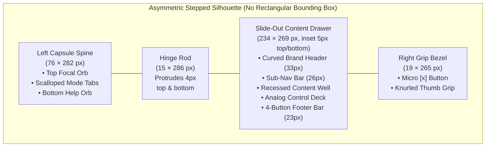

# The "Capsule-and-Drawer Appliance" Design Language & Agent Blueprint

When you ask a typical AI agent for a *"late-90s / Y2K desktop widget UI,"* it almost always defaults to **Windows 95 gray boxes** or **neon vaporwave**. It misses what actually made **Excite Assistant (1999)**, **Excite Messenger (2000)**, and **Trillian Cordillera (2001)** feel like physical objects from the future: **non-rectangular silhouette clipping, nested radial geometry, sliding drawer kinematics, and 1px industrial bevel craft.**

This document translates our binary decompilation of `Assistant.exe`, `em.exe`, and Trillian into a **formal Design Principle Language** and a **Copy-Paste Master Prompt** you can give to any coding agent to wrap *any* application in this exact paradigm.

---

## Part 1: The 7 Core Design Laws

### 1. Law of the Asymmetric Silhouette (Zero Outer Box)
The application **never** renders inside a standard rectangular bounding box or OS title bar. Its outer silhouette is a composite of distinct geometric volumes:
* **The Primary Spine / Capsule (Left):** A tall, stadium-rounded vertical chassis (`76px–95px` wide, `40px+` corner radius on outer corners) that anchors the app.
* **The Cylindrical Hinge Rod (Center Spine):** A full-height `14px–19px` vertical metallic/putty cylinder that visually separates navigation from content and extends `4px–6px` above and below the adjacent panels.
* **The Recessed Content Drawer (Right):** Slightly shorter than the primary spine (`5px–12px` inset from top and bottom), creating a stepped silhouette so the eye immediately reads the right half as sliding *out from inside* the left half.
* **The Terminal Grip Bezel (Far Right Edge):** A `19px`-wide curved cap with a micro `[x]` / `[▼]` window button at the top and a diamond-knurled or ridged thumb grip in the vertical center.



### 2. Law of Nested Radial Geometry ("Scalloped Ribbing")
Buttons and panels adjacent to a circular element must **never** use straight horizontal dividers.
* In `Assistant.exe`, the circular Red `X` Orb sits at the top of the left capsule.
* The 9 navigation buttons below it have **concave arc top-edges** that wrap around the bottom radius of the orb and repeat that curve down the entire vertical column like nested ribs (`61 × 30 px` per slice, overlapping vertically by `11 px`).
* **Design Rule:** Whenever a circular orb is placed in a header or footer, adjacent stacked controls must curve concavely around its socket.

### 3. Law of Spatial Kinematics (`TSlidingWins` Drawer Mechanics)
The UI operates as a **two-state physical gadget**:
* **Collapsed ("Spine Mode"):** The central Content Drawer (`234px`) retracts completely behind the Left Capsule, leaving only `[Left Capsule + Hinge Rod + Right Grip Bezel]` (`~95px` wide total), or docks as a tiny protruding tab on the monitor edge.
* **Expanded ("Drawer Mode"):** Clicking any Scalloped Tab on the spine or pulling the Right Grip Bezel slides the Content Drawer horizontally outward.

### 4. Law of the Tactile Focal Orb
Every appliance features one high-gloss, 3D spherical **Focal Orb** seated inside a dark recessed bevel socket (`25×25px` to `42×42px`):
* It serves simultaneously as **Brand Anchor**, **Live Telemetry Indicator** (glowing, spinning, or changing hue during network/CPU/AI activity), and **Master Menu / Status Switch**.
* A secondary, smaller **Utility Orb** (such as the sunken `?` sphere at the bottom of the Excite capsule) balances the vertical composition.

### 5. Law of Micro-Beveled Materiality (No Blurry Shadows)
Modern UI relies on soft, wide Gaussian drop-shadows (`box-shadow: 0 20px 40px rgba(...)`). This paradigm **forbids blurry shadows** in favor of crisp pixel-level industrial surfacing:
* **1px–2px Directional Specular & Crevice Bevels:** Top and left edges receive a crisp `1px` bone/cream highlight (`#EBE8D1`); bottom and right edges receive a `1px–2px` dark olive/charcoal shadow (`#84845B` → `#636033`).
* **Recessed Sunken Wells:** Data lists, text inputs, and LED meters sit inside sunken wells (`1px` dark top/left inner border, `1px` light bottom/right inner border).
* **Tactile Grip Textures:** Drag handles and empty bezel zones feature repeating pixel patterns—either **checkerboard diamond knurling** (Excite Assistant's right grip) or **horizontal grooved ridges** (Trillian's top/bottom grips).

### 6. Law of Conversational & Analog Telemetry
Quantitative controls and status readouts are framed as physical, human-friendly instruments rather than raw numbers:
* **Wedge Ramp Sliders:** Volume, speed, or intensity sliders use a rising triangular wedge track bookended by playful semantic labels (e.g., **`psst.`** on the quiet left and **`Yikes!`** on the loud right).
* **Segmented LED Block Meters:** Progress, buffering, or resource usage renders as a horizontal row of discrete sunken LED segments (`▮▮▮▮▮▮▮▮▮▮▮▮`).
* **Dotted Ledger Rows:** Metadata fields (`Artist`, `Song`, `Album`, or key-value telemetry) pair a beveled label block on the left with a white field divided by `1px` horizontal dotted rules.

### 7. Law of Four-State Surface Discipline
Every interactive element is a distinct physical keycap with 4 explicit states (modeled on `TBtnMap`):
1. **Normal:** Base chassis putty (`#C6C4AA`) with dark charcoal/olive label (`#333300`).
2. **Hover:** Surface stays raised, but the typography shifts immediately to high-contrast **Signal Crimson (`#CC0000`)**.
3. **Active / Latched:** The keycap depresses (`1px` inset shadow) and shifts to a darker **Recessed Olive-Slate (`#949481`)** with bright cream/white text (`#EBE8D1`).
4. **Disabled:** Flattened bevel with low-contrast etched gray text (`#848484`).

---

## Part 2: Authentic Extracted Design Tokens

Here are the exact color palettes extracted directly from the 1999 `Assistant.exe` (`bmp_317` 8-bit palette), 2000 `em.exe`, and 2001 Trillian *Cordillera* skins:

| Token Role | CSS Variable | 1999 Excite "Warm Putty / Tan" (Authentic `bmp_317`) | 2000 Excite "Slate Messenger" (`em.exe`) | 2001 Trillian "Cordillera Ice" |
| :--- | :--- | :--- | :--- | :--- |
| **Chassis Primary** | `--chassis-bg` | `#C6C4AA` (Warm Putty Tan) | `#B5BDD6` (Cool Steel Blue-Gray) | `#D6D6D6` (Brushed Silver) |
| **Chassis Secondary / Panel** | `--panel-bg` | `#B5B2A1` (Mid Khaki-Putty) | `#9CA6C5` (Mid Slate) | `#7B8C9C` (Frosted Slate Drawer) |
| **Specular Highlight (Top/Left)** | `--bevel-light` | `#EBE8D1` (Warm Bone Cream) | `#E6ECFF` (Ice White) | `#FFFFFF` (Pure Specular) |
| **Shadow Bevel (Bottom/Right)** | `--bevel-dark` | `#84845B` (Dark Olive Khaki) | `#5A6586` (Deep Slate Shadow) | `#737373` (Pewter Shadow) |
| **Deep Crevice / Outer Stroke** | `--crevice-stroke` | `#636033` (Deep Bronze-Olive) | `#29304A` (Navy Charcoal) | `#333333` (Dark Gunmetal) |
| **Active / Depressed Tab Fill** | `--tab-active-bg` | `#949481` (Recessed Sage-Gray) | `#6E7894` (Depressed Steel) | `#4A90E2` (Glossy Aqua Blue) |
| **Sunken Data Well Fill** | `--well-bg` | `#FFFFFF` (Crisp Paper White) | `#FFFFFF` (Pure White) | `#FFFFFF` (Pure White) |
| **Primary Label Text** | `--text-primary` | `#333300` (Deep Olive-Black) | `#1A1E2E` (Dark Navy) | `#112233` (Deep Slate) |
| **Hover / Alert Accent** | `--accent-hot` | `#C7131B` / `#CC0000` (Excite Crimson) | `#CC0000` (Signal Red) | `#00AA22` (Trillian LED Green) |
| **Active / Header Text** | `--text-inverse` | `#EBE8D1` / `#FFFFFF` (Cream White) | `#FFFFFF` (Pure White) | `#E0F0FF` (Etched Cyan-White) |

---

## Part 3: Domain Translation Matrix (Applying This to *Any* App)

To apply this GUI paradigm to any modern software, map the target application's features onto the **8 anatomical zones** of the appliance:

| Appliance Zone | Original 1999–2001 Role | Modern App Equivalent (AI Agent, DevOps Tool, Music/Media, Finance, Productivity) |
| :--- | :--- | :--- |
| **1. Top Focal Orb (`28–40px` sphere)** | Excite `X` / Trillian Status Orb | **System Heartbeat & Master Trigger:** Pulses when AI is streaming, build is running, or socket is live. Clicking toggles global online/offline state or opens the master command menu. |
| **2. Scalloped Spine Tabs (`6–9` concave ribs)** | *Email, Search, News, TuneIn, Stocks, Weather...* | **Primary App Modes / Workspaces:** The 5 to 9 core views of the app (e.g., *Chat, Tasks, Logs, Metrics, Deploy, Config*). Hover turns text crimson; active depresses into dark olive/slate. |
| **3. Cylindrical Hinge Rod (`15px` vertical bar)** | Structural spine between capsule & drawer | **Drawer Splitter & Activity Spine:** Clicking collapses/expands the right drawer; can optionally house a vertical progress fill or unread indicator. |
| **4. Curved Drawer Header (`33px` tall)** | `eXcite ASSISTANT` embossed banner | **Application Brand & Active Workspace Title:** Embossed dual-tone typography (dark olive + cream white) on a convex horizontal pillow bevel. |
| **5. Sub-Navigation Strip (`26px` tall)** | `tunein` logo + `◄ Networks` \| `◄ Channel` | **Context Filter / Breadcrumb Bar:** Left 1/3 shows the current module icon; right 2/3 houses two beveled dropdown/cycle buttons (`◄ Environment` \| `◄ Filter`). |
| **6. Recessed Content Well (`150–200px` tall)** | News headlines, Buddy Tree, or Station Banner | **Primary Interactive Viewport:** Sunken white/light-tan well containing collapsible `[+]/[-]` trees, dotted key-value ledger rows, live logs, or chat messages, paired with a custom pill scrollbar (`▲`/`▼` circles). |
| **7. Analog Control Deck (`60–110px` tall)** | `Artist/Song/Album` + `psst...Yikes!` ramp + `Play/Pause/Stop` + LED meter | **Action & Telemetry Deck:** Dotted status fields, a triangular wedge slider (`psst.` → `Yikes!` for temperature/speed/volume/verbosity), transport buttons (`▶ Run`, `❚❚ Pause`, `■ Stop`), and a 15-segment LED activity bar. |
| **8. Segmented Footer + Right Grip (`23px` bar + `19px` bezel)** | `☺ Tell a Friend \| Personalize \| Sign In \| Prefs` + `[x]` grip | **Utility Footer & Window Chrome:** 4-segment micro-button bar for global utilities (*Share, Theme, Account, Prefs*), capped on the right by the knurled drawer handle and `[x]` collapse box. |

---

## Part 4: The Copy-Paste Agent Blueprint Prompt

Copy and paste the prompt block below into **any AI coding agent** when you want it to build or reskin an application using this exact GUI language:

```markdown
# UI ARCHITECTURE BRIEF: 1999–2001 "Tactile Capsule-and-Drawer Desktop Appliance" (Excite Assistant / Trillian Paradigm)

Build the interface for [INSERT YOUR APP NAME & FUNCTIONALITY HERE] as a non-rectangular, tactile late-1990s / Y2K desktop appliance widget modeled directly on the decompiled GUI architecture of **Excite Assistant v1.1 (1999)** and **Trillian Cordillera (2001)**.

## 1. Strict Visual & Structural Rules (DO NOT VIOLATE)
1. **NO Rectangular Outer Window:**
   - Do NOT wrap the application in a standard rectangular card, browser page, or OS window frame.
   - Render the application over a contrasting desktop backdrop (`#008080` classic teal or dark grid) as an **asymmetric, multi-volume hardware silhouette** composed of four locked horizontal zones:
     - **Zone A — Left Capsule Spine (`76px` wide, `282px+` tall):** Stadium-rounded on the top-left and bottom-left corners (`border-radius: 38px 0 0 38px`).
     - **Zone B — Cylindrical Hinge Rod (`15px` wide):** A full-height vertical cylinder between the Left Capsule and Right Drawer that protrudes `4px` above and below the capsule (`border-radius: 7px`) with a horizontal metallic/putty gradient (`#84845B -> #EBE8D1 -> #C6C4AA -> #636033`).
     - **Zone C — Slide-Out Content Drawer (`234px–320px` wide):** Inset vertically by `5px` from the top and bottom of the Left Capsule so it physically reads as a drawer sliding out from inside the spine. Supports smooth horizontal collapse/expand (`TSlidingWins` drawer mechanic).
     - **Zone D — Right Grip Bezel (`19px` wide):** Caps the right edge of the drawer (`border-radius: 0 24px 24px 0`), housing a recessed `11x11px` `[x]` button at the top and a `19x48px` **diamond-knurled pixel grip** in the vertical center that toggles the drawer open/closed.

2. **Nested Radial Geometry ("Scalloped Rib Tabs"):**
   - At the top-center of the Left Capsule, place a recessed socket containing a glossy 3D **Focal Status Orb (`28x28px`)**.
   - Directly below the orb, stack 6 to 9 **Scalloped Navigation Tabs (`61px` wide)**. Their top and bottom borders MUST curve concavely (via SVG clip-path, radial background gradient, or curved border mask) to hug the circular contour of the top orb like nested ribs.
   - Place a smaller sunken `?` or utility orb (`23x23px`) at the bottom of the Left Capsule.

3. **Authentic 1999 "Excite Warm Putty / Tan" Color Tokens:**
   - `--chassis-bg`: `#C6C4AA` (Primary warm putty tan)
   - `--panel-bg`: `#B5B2A1` (Mid khaki surface)
   - `--bevel-light`: `#EBE8D1` (1px top/left specular highlight)
   - `--bevel-dark`: `#84845B` (1px–2px bottom/right olive shadow)
   - `--crevice-stroke`: `#636033` (1px deep bronze-olive outer/divider stroke)
   - `--tab-active-bg`: `#949481` (Depressed sage-olive active tab fill)
   - `--well-bg`: `#FFFFFF` (Crisp white sunken data wells)
   - `--text-primary`: `#333300` (Deep olive-black bold UI text)
   - `--text-inverse`: `#EBE8D1` (Cream white active/header text)
   - `--accent-hot`: `#CC0000` (Crimson red orb glow & button hover text)

4. **Crisp 1px Pixel Bevels (NO Blurry Drop Shadows):**
   - Never use `box-shadow` with a blur radius greater than `2px`.
   - Every raised panel and button must use crisp directional bevels: `border-top: 1px solid var(--bevel-light); border-left: 1px solid var(--bevel-light); border-right: 1px solid var(--bevel-dark); border-bottom: 1px solid var(--bevel-dark); outline: 1px solid var(--crevice-stroke);`.
   - Every sunken well, LED slot, and active/pressed button reverses the bevel (`--bevel-dark` on top/left, `--bevel-light` on bottom/right).

5. **Four-State Button Discipline:**
   - **Normal:** `--chassis-bg` fill, `--text-primary` text, raised 1px bevel.
   - **Hover:** Text immediately changes to `--accent-hot` (`#CC0000` crimson) while surface stays raised.
   - **Active / Selected:** Surface shifts to `--tab-active-bg` (`#949481`), text shifts to `--text-inverse` (`#EBE8D1`), bevel inverts to sunken.
   - **Disabled:** Etched `#848484` text with flat border.

6. **Required Drawer Internal Anatomy (Top to Bottom):**
   - **Row 1 — Convex Pillow Header (`33px` tall):** Smooth vertical gradient (`#EBE8D1 -> #C6C4AA -> #84845B`) with dual-tone brand typography (first word in `#636033` with starburst/icon accent, second word tracked out in bold uppercase `#FFFFFF` with `1px` `#636033` drop shadow).
   - **Row 2 — Module Sub-Bar (`27px` tall):** Left 1/3 displays the active module badge; right 2/3 contains two raised bevel selector buttons (`◄ [Filter 1]` | `◄ [Filter 2]`).
   - **Row 3 — Sunken Content Well:** White (`#FFFFFF`) or warm-tan recessed viewport with collapsible `[+]`/`[-]` tree groups or dotted-rule ledger rows (`Artist / Song / Album` style: `44px` beveled label column on the left + white value rows separated by `1px dotted #84845B`).
   - **Row 4 — Analog Control & Telemetry Deck:**
     - A **Rising Triangular Wedge Slider** bookended by conversational micro-labels (e.g., `psst.` on the low end, `Yikes!` on the high end) with a draggable vertical thumb.
     - **Transport / Action Keycaps** (`▶` / `❚❚` / `■` geometric icons stacked above 10px labels) paired with a **15-segment sunken LED block meter** (`▮▮▮▮▮`).
   - **Row 5 — 4-Segment Utility Footer (`23px` tall):** Four equal-width beveled micro-buttons across the bottom (`☺ Share` | `Personalize` | `Sign In` | `Prefs`).

7. **Typography:**
   - Use crisp, compact sans-serif UI typography (`10px–11px` Tahoma, Verdana, Geneva, or MS Sans Serif, `font-weight: 700` for tabs/buttons) with tight line-height (`1.1`) and `user-select: none`.
```
