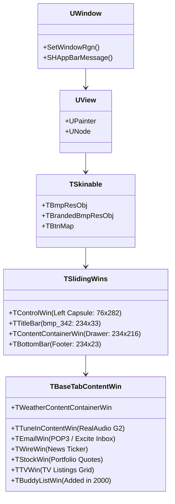

# Decompiling the 1999 "Tan" Excite Desktop Widget (`Excite Assistant` & `Excite Messenger`)

Your memory is spot-on: in **June–September 1999**, **Excite@Home** released a floating, non-rectangular desktop portal & internet radio widget called **Excite Assistant** (`Assistant.exe`, v1.1.3.3), dressed in a distinctive **warm tan / khaki / olive-putty** color palette.

Even more remarkably, its layout—a **rounded vertical capsule on the left with a circular orb button** and a **slide-out drawer on the right** with a textured grip handle—is the direct structural ancestor of the 2001–2002 Trillian *Cordillera* interface.

We located the original 1999–2001 installers in archival dumps (`InstallAssistant.EXE`, `InstEm.exe`, `ExcitePrivateMessengerSetup1.0.3.2-2.exe`, and `excitepal.hqx`), unpacked their Wise Installer raw deflate streams, extracted their PE `.rsrc` resource trees and C++ RTTI class tables, and reconstructed the 1999 GUI directly from its binary sprite sheets and coordinate tables.

---

## 1. Visual Reconstruction & Extracted Master Sprite Sheets

### Pixel-Exact Reconstruction of Excite Assistant v1.1.3.3 (September 1999)
Composited directly from `Assistant.exe`'s internal `RT_BITMAP` resources (`#317`, `#342`, `#132`) using the `[x, y, w, h]` layout coordinates stored in its Win32 `RT_STRING` table:


> [!NOTE]
> Notice why seeing Trillian triggered this memory:
> 1. **Left Capsule (`76 × 282 px`):** A curved handheld bezel with a 3D circular **red Excite `X` orb** at the top, **9 scalloped concave navigation tabs** (*Email, Search, News, TV Listings, TuneIn, Stocks, Weather, Horoscopes, Deals*), a `?` orb at the bottom, and a vertical cylindrical divider rod.
> 2. **Slide-Out Right Drawer (`234 × 269 px`):** Toggled via the diamond-textured grip on the right bezel (`19 × 265 px`). When closed, the right bezel snapped directly against the vertical divider rod (`95 px` total width) or docked as a mini-tab on the screen edge via `SHAppBarMessage`.

---

### Decompiled Sprite Sheets: From 1999 *Excite Assistant* to 2000 *Excite Messenger*

In **September 2000**, Excite@Home took the exact same `Assistant.exe` C++ engine and transformed it into **Excite Messenger (`em.exe`)**—adding *Buddies* and *Buddy Card* to the top of the tab stack, swapping the red `X` orb for a talking `"e"` head, and recoloring the **1999 warm tan** sprite sheet into **2000 metallic slate-blue**:

````carousel

<!-- slide -->

<!-- slide -->

<!-- slide -->

````

---

## 2. Under the Hood: How `Assistant.exe` & `em.exe` Were Engineered

### A. Unpacking the Binaries
Both `InstallAssistant.EXE` (1999) and `InstEm.exe` (2000) were packaged with the **Wise Installation System**, which appends contiguous raw `DEFLATE` streams (`zlib` windowBits `-15`, each followed by a 32-bit CRC32) after the stub PE header:

| Binary Archive | Extracted Payload | Details |
| :--- | :--- | :--- |
| [`InstallAssistant.EXE`](file:///Users/dwjohnston/.gemini/antigravity/brain/422273d3-dd11-490e-94e2-75cc47bbc6cc/scratch/InstallAssistant.EXE) | [`Assistant.exe`](file:///Users/dwjohnston/.gemini/antigravity/brain/422273d3-dd11-490e-94e2-75cc47bbc6cc/scratch/eassist_extracted/stream_16_0x2bd46.exe_or_dll) (`790 KB`) + 3 `.ttf` fonts | Contains 8-bit RLE-compressed BMP sprite sheets (`#317`, `#342`, `#229`, `#318`), WAV alerts, and Carter & Cone / Tobias Frere-Jones TrueType fonts (`home.ttf`). |
| [`InstEm.exe`](file:///Users/dwjohnston/.gemini/antigravity/brain/422273d3-dd11-490e-94e2-75cc47bbc6cc/scratch/InstEm.exe) | [`em.exe`](file:///Users/dwjohnston/.gemini/antigravity/brain/422273d3-dd11-490e-94e2-75cc47bbc6cc/scratch/instem_extracted/stream_18_0x33219.exe_or_dll) (`1.45 MB`) + [`stream_19.png`](file:///Users/dwjohnston/.gemini/antigravity/brain/422273d3-dd11-490e-94e2-75cc47bbc6cc/excite_messenger_2000_spritesheet.png) | Compiled with full C++ RTTI symbols (`203` classes), revealing the entire internal GUI framework. |
| [`ExcitePrivateMessengerSetup.exe`](file:///Users/dwjohnston/.gemini/antigravity/brain/422273d3-dd11-490e-94e2-75cc47bbc6cc/scratch/ExcitePrivateMessengerSetup.exe) | `X8PLAY.EXE`, `X8SKIN.DLL`, `X8MSG.DLL`, `*.VPA`, `*.X8N` | A separate Ubique / Virtual Places-based client featuring avatar gestures (`VPAG0100`) and animated desktop notifiers (`CLASSIC.X8N`, `ROBOT.X8N`, `DOG.X8N`). |

---

### B. The Custom C++ GUI Engine (`UWindow` / `TSkinable` / `TSlidingWins`)
Because standard Windows 95/98 controls (`USER32.dll` buttons and frames) were strictly rectangular and gray, Excite@Home wrote a custom retained-mode scene graph and widget toolkit in C++. Extracting the RTTI (`Run-Time Type Information`) descriptors from `em.exe` reveals a two-layer architecture:



1. **Non-Rectangular Window Clipping (`GDI32.dll` & `USER32.dll`):**
   - `Assistant.exe` imports `CreateRectRgn`, `CreatePolygonRgn`, `CombineRgn`, and `SetWindowRgn`.
   - At startup and during drawer animation (`TSlidingWins`), it scans the outer silhouette of the capsule and drawer where pixels equal pure blue (`RGB(0, 0, 255)`), builds a scanline `HRGN` (union of 1-pixel-tall horizontal `CreateRectRgn` strips), and calls `SetWindowRgn(hWnd, hRgn, TRUE)` so the OS clips away the corners and reveals the desktop underneath.
2. **8-Bit Indexed Texture Atlas (`BI_RLE8`) & Palette Management:**
   - In 1999, many Windows 95/98 machines still ran in 256-color (8-bit) video modes. `bmp_317` is stored as a `600 × 481` 8-bit Run-Length Encoded (`BI_RLE8`) Device-Independent Bitmap (`221 KB`) with a custom 256-color palette managed via `CreatePalette`, `SelectPalette`, and `RealizePalette`.
   - Two palette indices act as chroma keys:
     - **Pure Blue (`#0000FF`):** Transparent pixel mask for `BitBlt` / region generation.
     - **Chartreuse Lime (`#CCFF00` in 1999) / Crimson Red (`#CC0000` in 2000):** Sprite-sheet gutter separator.
3. **Data-Driven Sprite Slicing via `RT_STRING`:**
   - Instead of hardcoding pixel coordinates in C++, `TBtnMap` reads multi-state rectangle definitions directly from the PE's `RT_STRING` resource table. Each interactive control defines 4 states (`0: Dest [x, y, w, h]`, `1: Normal [sx, sy, w, h]`, `2: Hover [sx, sy]`, `3: Active/Pressed [sx, sy]`):
   ```text
   // Extracted from Assistant.exe RT_STRING table:
   [  75] 0, 0, 76, 282                                             // Left Capsule Frame
   [   3] 76, 5, 234, 33                                            // Top Header (bmp_342)
   [   4] 76, 38, 234, 153                                          // Upper Content Drawer
   [  96] 76, 191, 234, 63                                          // Lower Player Drawer
   [  68] 76, 254, 234, 23                                          // Bottom Toolbar
   [  71] 310, 8, 19, 265                                           // Right Drawer Bezel
   [   2] 0: 0,0,0,0, 1: 221,58,61,30,  2: 97,30,  3: 159,30        // "Email" Scalloped Tab
   [  60] 0: 0,0,0,0, 1: 283,28,61,30,  2: 97,49,  3: 159,49        // "Search" Scalloped Tab
   [  62] 0: 0,0,0,0, 1: 283,118,61,30, 2: 97,106, 3: 159,106       // "TuneIn" Scalloped Tab
   [  29] 0: 80,0,77,26,  1: 0,0,77,26,     2: 78,0,    3: 156,0    // "< Networks" Button
   [  30] 0: 157,0,77,26, 1: 235,455,77,26, 2: 235,428, 3: 235,401  // "< Channel" Button
   ```

---

## 3. GUI Design Study: Why It Looked Like That

1. **The "Warm Putty / Khaki" Industrial Palette (1998–1999):**
   - Before Apple's *Aqua* (2000) and Windows XP's *Luna* (2001) shifted software toward glossy blues and candy plastics, late-90s industrial design was dominated by **3Com's PalmPilot / Palm III**, **IBM WorkPad**, and warm anodized titanium/champagne electronics.
   - Excite Assistant's palette—warm khaki-beige (`#C8C8B4`), olive shadow bevels (`#8C8C73`), muted sage-gray active tabs (`#949484`), and high-contrast crimson hover highlights (`#CC0000`)—made the app feel like a physical **desktop pager/PDA** sitting on top of your Windows 98 screen.
2. **Scalloped Nesting & Tactile Micro-Details:**
   - Look closely at the left capsule: the 9 navigation buttons aren't flat rectangles. Their top and bottom edges curve upward on the left to hug the circular red `X` orb, creating a continuous, organic scalloped ribcage.
   - The volume slider replaces sterile decibel numbers with conversational copy: **`psst.`** on the quiet end of the ramp and **`Yikes!`** on the loud end.
3. **The Collapsible "Appliance Drawer" Pattern:**
   - On 800×600 CRT monitors, screen real estate was precious. Designing the UI as a narrow vertical spine (`76 px`) with a slide-out content drawer (`234 px`) allowed the app to stay docked ("Always keep Assistant on top" / "Minimize to tab on screen's edge") without blocking the user's browser.

---

## 4. Other Apps from This Same "Y2K Gadget GUI" Movement

If you want to study or decompile sibling apps from that exact 1998–2002 window where developers rebelled against rectangular Win32 forms, these are the defining examples:

````carousel

<!-- slide -->

````

* **Sonique Media Player (1998–2001, Media Science / Lycos):** Famous for its non-rectangular sci-fi navigation console, spring-physics menu transitions, and irregular alpha/region masks.
* **Odigo Messenger (1998–2002, NovaWiz):** A curved, gadget-style instant messenger and "co-browsing" radar that showed who else was on the same website as you, featuring detachable rounded buddy drawers and custom skins.
* **NeoPlanet (1998–2001, Bigfoot International):** Wrapped Microsoft's `MSHTML` (`Trident`) engine inside a rounded, metallic desktop appliance shell with a right-hand channel sidebar very similar to Excite's portal tabs.
* **Excite Virtual Places (`VP Chat`) & Gooey (1999, Ubique / Hypernix):** Browser companion widgets that docked to the edge of Internet Explorer/Netscape and turned any URL into a live chat room.
* **EntryPoint / PointCast (1996–2000):** The desktop ticker/portal bars that pioneered pushed news, stocks, weather, and horoscopes directly to the Windows desktop.

---

## 5. Deep x86 Disassembly of `Assistant.exe` (`ImageBase = 0x00400000`)

Disassembling the `.text` section (`0x401000`–`0x448000`) of `Assistant.exe` (compiled with Microsoft Visual C++ 6.0 / MFC 4.2) reveals the exact four C++ methods that give the 1999 Excite Assistant its signature geometry and physical feel:

### 5.1 Scalloped Tab CSG Region Builder (`0x004297B8`)
Rather than scanning every pixel of `bmp_317` at startup to build the hit-test masks for the 9 overlapping scalloped tabs (`[0x0046AC54]`), `Assistant.exe` constructs each tab's concave top-left rib and convex outer corners using **Constructive Solid Geometry (CSG)** via `CombineRgn`:

```x86asm
; 0x004297B8: Build Scalloped Tab HRGN via Boolean CSG
004297c2: mov   esi, [0x469bf4]       ; GDI32!CreateRectRgn
004297c8: push  0x23                  ; bottom = 35
004297ca: push  0x0e                  ; right  = 14
004297cc: push  0x16                  ; top    = 22
004297ce: push  0x00                  ; left   = 0
004297d0: call  esi                   ; hRgnBase = CreateRectRgn(0, 22, 14, 35)
...
0042982a: mov   edi, [0x469bf0]       ; GDI32!CreateEllipticRgn
0042984e: push  0x22                  ; bottom = 34
00429850: push  0x28                  ; right  = 40
00429852: push  0x06                  ; top    = 6
00429854: push  0x00                  ; left   = 0
00429856: call  edi                   ; hRgnCut = CreateEllipticRgn(0, 6, 40, 34)
00429864: push  0x04                  ; fnCombineMode = RGN_DIFF (4)
00429866: push  eax                   ; hrgnSrc2 = hRgnCut (ellipse to subtract!)
00429867: push  ebp                   ; hrgnSrc1 = hRgnTab
00429868: push  ebp                   ; hrgnDest = hRgnTab
00429869: call  ebx                   ; CombineRgn(hRgnTab, hRgnTab, hRgnCut, RGN_DIFF)
```
By subtracting (`RGN_DIFF = 4`) an ellipse at `(0, 6, 40, 34)` from a rectangle at `(0, 22, 14, 35)`, the engine carves out the concave inward curve where each tab tucks underneath the tab above it.

### 5.2 `TSlidingWins` 3-Part Dynamic `HRGN` Composer (`0x0042C930`)
On every frame of the drawer slide animation, `TSlidingWins` recomposes the window's silhouette from three cached sub-regions (`[esi+0x4C]` = Left Capsule `HRGN`, `[esi+0x54]` = Right End-Cap Bezel `HRGN`, `[esi+0x60]` = Current Drawer Width $w$):

$$\text{HRGN}_{\text{win}}(w) = \text{HRGN}_{\text{LeftCapsule}} \;\cup\; \operatorname{Rect}(0, 0, w, h) \;\cup\; \operatorname{Offset}(\text{HRGN}_{\text{RightBezel}}, w, 0)$$

It then commits the combined region to the OS window manager via `SetWindowRgn(hWnd, hRgn, TRUE)` at `0x00430C34`.

### 5.3 Integer Exponential Ease-Out Physics (`0x00439D89`)
To achieve smooth ease-out deceleration on 1999 Pentium II CPUs without floating-point math, the timer tick handler uses an arithmetic right shift by 3 bits (`sar ecx, 0x3`), dividing the remaining distance to the target width by $8$ on every tick:

```x86asm
; 0x00439D89: Integer Exponential Ease-Out Damper
00439d86: mov   ecx, eax              ; ecx = currentPos
00439d88: dec   edx                   ; decrement tick counter
00439d89: sub   ecx, [ebp-0x0c]       ; ecx = currentPos - targetPos (delta)
00439d8c: sar   ecx, 0x03             ; ecx = delta >> 3  (divide remaining distance by 8)
00439d8f: sub   eax, ecx              ; currentPos -= (delta >> 3)
```

### 5.4 `SHAppBarMessage` Screen-Edge Docker (`0x00439E35`)
When collapsed, `Assistant.exe` queries the Windows shell taskbar geometry using a 36-byte (`0x24`) `APPBARDATA` struct (`mov dword ptr [ebp-0x58], 0x24`) and calls `SHELL32!SHAppBarMessage(ABM_GETTASKBARPOS = 5, &abd)` (`0x00439E88`) so the collapsed Excite tab docks flush against the work-area edge without overlapping the Windows 98 taskbar.

---

## 6. Sibling App Binary Teardowns (Sonique 1.96, Odigo 0.99, Excite Private Messenger)

We also unpacked the installers for three sibling apps from the same 1999–2001 non-rectangular appliance movement:

````carousel

<!-- slide -->

````

1. **Sonique v1.96 (`sonique196.exe` → `Sonique.exe`):**
   - Contains an embedded `DAF\0LIST` skin archive (`zlib_40`) with two PNG textures (`/rgn/png` and `/pos/cur/skn`): a `577x444` brushed-steel & royal-blue industrial chassis (`sonique_daf_02.png`) keyed against pure green `#00FF00`, and a 12-frame `196x19` 3D rotating orb strip (`sonique_daf_00.png`).
   - Instead of CSG primitives, Sonique stores precomputed scanline span tables (`/rgn/main`, `/rgn/mid`, `/rgn/small`) inside its `.sgf` skin container and feeds them directly into `ExtCreateRegion` to switch between its three physical form-factor states (`Full Pod`, `Mid Console`, `Mini Orb`).
2. **Odigo Messenger v0.99 (`odigo99.zip` → `Odigo.exe` + `WinMan.dll`):**
   - Uses a dedicated window-management DLL (`WinMan.dll`) that exports `CreateRegionFromFile` and `SetWindowRegion` alongside a custom `COdigoButton` class that arranges circular chrome buttons along a parabolic arc (`x^2 + y^2 = r^2`) on the left bezel while sliding rounded drawers out to the right.
3. **Excite Private Messenger (`ExcitePrivateMessengerSetup.exe` → `X8SKIN.DLL` + `*.X8N`):**
   - Built on Ubique's Virtual Places (`VP`) engine; stores animated desktop character alerts (`*.X8N`: `DEFAULT.X8N`, `DOG.X8N`, `GIRL1.X8N`, ` GUY1.X8N`) as multi-stream zlib archives combining an indexed-color sprite strip with per-frame `RGNDATA` scanline structures (`rectCount`, `boundingBox`, and arrays of `(x0, y0, x1, y1)` spans) so an animated character can walk directly across the user's Windows desktop without a window frame.
